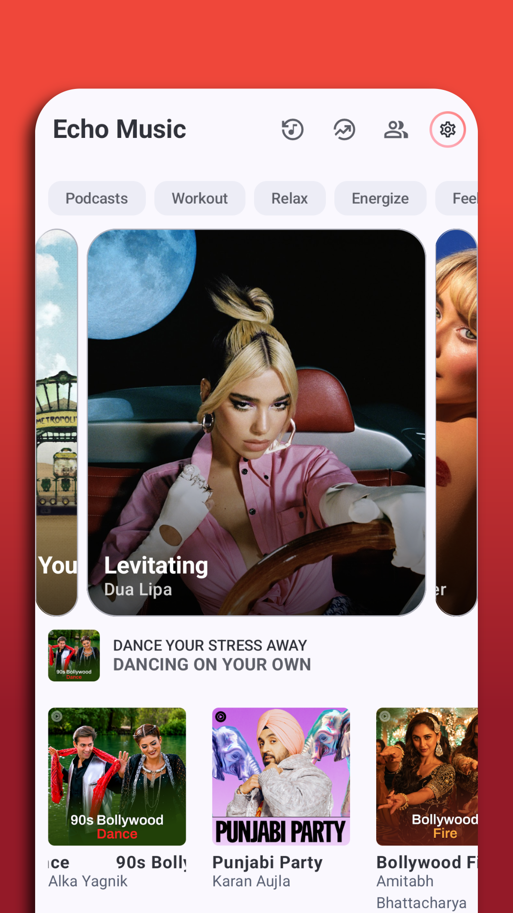
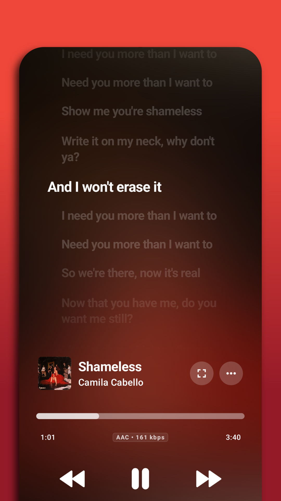

# Swarr

<div align="center">
  
  <h3>An Android music player for discovery, playback, lyrics, and a listening experience you can customize.</h3>
  <p>
    <a href="https://github.com/prxshxnt-dev/Swarr/releases"></a>
    <a href="https://github.com/prxshxnt-dev/Swarr/blob/main/LICENSE"></a>
    <a href="https://github.com/prxshxnt-dev/Swarr/actions"></a>
  </p>
</div>

Swarr is an independently branded Android music client built on an upstream open-source codebase. This repository contains the complete Android project: application code, shared modules, playback and lyrics components, provider integrations, build configuration, and project documentation.

> **Current app identity:** `com.swarr.com` · **Current source version:** `1.5` (`versionCode` 172). Debug builds use `com.swarr.com.debug`.

## Contents

- [What Swarr includes](#what-swarr-includes)
- [Screenshots](#screenshots)
- [Project layout](#project-layout)
- [Get Swarr](#get-swarr)
- [Build and test](#build-and-test)
- [Build variants](#build-variants)
- [Optional services](#optional-services)
- [In-app updates](#in-app-updates)
- [Package and upgrade compatibility](#package-and-upgrade-compatibility)
- [Contributing](#contributing)
- [Developers and acknowledgements](#developers-and-acknowledgements)
- [License](#license)

## What Swarr includes

- **Discovery:** Search and browse music, charts, moods, genres, podcasts, and related content.
- **Playback:** Background playback, queue management, crossfade, audio/video switching, and offline downloads.
- **Lyrics:** Synchronized and word-timed lyrics, multiple display styles, and optional translation providers.
- **Listening tools:** Music recognition, listening history, recommendations, and listening summaries.
- **Swarr Brain:** Listening-profile insights and AI-assisted recommendations where the required services are available.
- **Customization:** Material You styling, player layouts, interface density, artwork options, and playback settings.
- **Android integration:** Media notifications, system media controls, Bluetooth playback handling, and supported casting features in the GMS build.
- **Swarr Connect:** Local-network pairing and playback handoff with a compatible desktop client.

Feature availability can vary by build variant, device, configured provider, and upstream service. Integrations that depend on third-party services are subject to those services' availability and policies.

## Screenshots

<div align="center">
  
  
  
</div>

## Project layout

| Directory | Responsibility |
| --- | --- |
| `app/` | Android application, manifest, resources, screens, and app integrations |
| `core/`, `domain/`, `playback/` | Shared application, domain, and playback layers |
| `lyrics/`, `betterlyrics/`, `lrclib/`, `paxsenixlyrics/` | Lyrics functionality and provider implementations |
| `innertube/`, `youlyplus/`, `kugou/` | Music-service and provider integrations |
| `canvas/`, `swarrcanvas/`, `applecanvas/` | Animated artwork and canvas providers |
| `audio-dsp/`, `dsp-core/`, `usbaudio/` | Audio processing and device-audio support |
| `docs/` | Feature, integration, and compatibility documentation |
| `fastlane/` | Android store metadata |
| `scripts/` | Development and maintenance scripts |
| `gradle/` | Gradle wrapper and dependency/version configuration |

## Get Swarr

Download published builds from **[GitHub Releases](https://github.com/prxshxnt-dev/Swarr/releases)**. Check the release notes for the version, supported build variant, and any upgrade instructions before installing.

The production Android package is `com.swarr.com`. A debug APK is a separate application (`com.swarr.com.debug`) and is intended for development and testing, not as an in-place replacement for the production app.

## Build and test

### Requirements

- Android Studio and a compatible Android SDK
- JDK 21
- Android SDK platform and build-tools versions required by `app/build.gradle.kts`
- Git

### 1. Clone the repository

```bash
git clone https://github.com/prxshxnt-dev/Swarr.git
cd Swarr
```

### 2. Configure the Android SDK

Copy the template and set `sdk.dir` to the SDK installation on your machine:

```properties
# local.properties
sdk.dir=/absolute/path/to/Android/Sdk
```

On Windows, the SDK is commonly located at `%LOCALAPPDATA%\Android\Sdk`. Keep `local.properties` local; do not commit machine-specific paths.

### 3. Build the universal FOSS debug APK

```bash
# macOS / Linux
./gradlew :app:assembleUniversalFossDebug

# Windows PowerShell
.\gradlew.bat :app:assembleUniversalFossDebug
```

The APK is generated at:

```text
app/build/outputs/apk/universalFoss/debug/app-universal-foss-debug.apk
```

### 4. Run the unit tests

```bash
# macOS / Linux
./gradlew :app:testUniversalFossDebugUnitTest

# Windows PowerShell
.\gradlew.bat :app:testUniversalFossDebugUnitTest
```

For environment setup, troubleshooting, and additional project-specific instructions, see [SETUP.md](SETUP.md).

## Build variants

Swarr uses ABI and service-integration build dimensions. The universal variants are the most convenient starting point for local development.

| Variant | Intended use | Configuration |
| --- | --- | --- |
| `UniversalFossDebug` | Local development and testing | FOSS build; no Google Play Services dependency |
| `UniversalFossRelease` | FOSS distribution | Requires the appropriate release signing configuration |
| `UniversalGmsDebug` | Development with Google services | Requires a matching Firebase configuration when that integration is enabled |
| `UniversalGmsRelease` | GMS distribution | Requires matching Firebase configuration and release signing credentials |

Debug variants append `.debug` to the application ID. Release variants use `com.swarr.com`.

## Optional services

The FOSS build can be built without Firebase configuration. To enable Firebase analytics or crash reporting, register the exact Android application ID in the Firebase project and place its matching `google-services.json` at `app/google-services.json`.

- Production application ID: `com.swarr.com`
- Debug application ID: `com.swarr.com.debug`

A Firebase file created for a previous package ID will not match these variants. Do not commit private service credentials, signing keys, API secrets, or `local.properties`. Other provider integrations may require separate credentials or endpoints; see [SETUP.md](SETUP.md).

## In-app updates

The in-app updater checks the [Swarr GitHub Releases page](https://github.com/prxshxnt-dev/Swarr/releases). Before handing an APK to Android's package installer, the updater validates the release asset's SHA-256 digest, expected package identity, and trusted signing certificate.

For an APK to qualify as a production OTA update, it must:

1. Use the production application ID `com.swarr.com`.
2. Be signed with the same trusted certificate as the installed production app.
3. Have a higher Android `versionCode` than the installed app.

Do not publish debug-signed APKs as production updates. Package or signing-certificate mismatches are rejected rather than treated as normal updates.

## Package and upgrade compatibility

The production application ID is `com.swarr.com`. Android treats this as a different application from older installations that used `swarr.prashant`; installing it does not automatically migrate private app data.

- Back up or export important playlists and data before switching package identities.
- Android keeps private app data scoped to each application ID.
- An APK signed with a different certificate cannot update an existing installation in place.
- The historical Kotlin namespace `echo.music.iad1tya` is retained for source and integration compatibility. It is not the installed Android application ID and is not the Swarr product name.

Compatibility-sensitive identifiers, database history, and required upstream notices are documented in [docs/REBRANDING_COMPATIBILITY.md](docs/REBRANDING_COMPATIBILITY.md). They should not be renamed indiscriminately: some are persisted or externally consumed identifiers.

## Contributing

Bug reports, focused fixes, and improvements are welcome. Before opening a pull request:

1. Read [CONTRIBUTING.md](CONTRIBUTING.md) and the [Code of Conduct](CODE_OF_CONDUCT.md).
2. Describe the affected behaviour and include reliable reproduction steps for bugs.
3. Preserve playback, stored data, package compatibility, and provider integrations unless the change explicitly addresses them.
4. Run the relevant tests and build task; include screenshots for user-interface changes.

Report security issues using [SECURITY.md](SECURITY.md), not a public issue.

## Developers and acknowledgements

<div>
  <a href="https://github.com/prxshxnt-dev"></a>
  <a href="https://github.com/sachit1751-art"></a>
</div>

- **Prashant** — [GitHub](https://github.com/prxshxnt-dev)
- **Sachit** — [GitHub](https://github.com/sachit1751-art)

Swarr builds on the work of the open-source Android music community, including the upstream Echo Music project and the libraries and projects referenced throughout this repository. The upstream project name is retained only where needed for provenance, compatibility, and licensing attribution. Original copyright notices and license terms remain applicable.

## License

Swarr is distributed under the **GNU General Public License v3.0**. See [LICENSE](LICENSE) for the complete license text.
