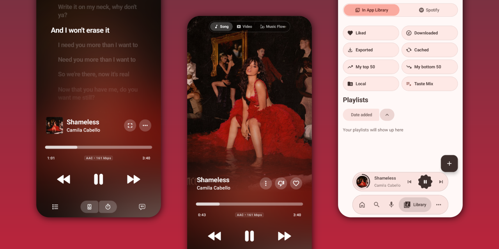

# Swarr

<div align="center">
  
  <p><strong>An open-source Android music player built around discovery, playback, lyrics, and a customizable listening experience.</strong></p>
  <p>
    <a href="https://github.com/prxshxnt-dev/Swarr/releases"></a>
    <a href="https://github.com/prxshxnt-dev/Swarr/blob/main/LICENSE"></a>
    <a href="https://github.com/prxshxnt-dev/Swarr/actions"></a>
  </p>
</div>

Swarr is an independently branded Android music client built on an upstream open-source codebase. This repository contains the Android application, supporting modules, provider integrations, build configuration, documentation, and Swarr-specific product identity.

> **Application identity:** The production application ID is `com.swarr.com`; debug builds use `com.swarr.com.debug`. This differs from the application ID used by earlier Swarr builds. See [Upgrade and compatibility notes](#upgrade-and-compatibility-notes) before installing.

## Contents

- [Features](#features)
- [Screenshots](#screenshots)
- [Project structure](#project-structure)
- [Build from source](#build-from-source)
- [Build variants](#build-variants)
- [Firebase and optional services](#firebase-and-optional-services)
- [In-app updates](#in-app-updates)
- [Upgrade and compatibility notes](#upgrade-and-compatibility-notes)
- [Contributing](#contributing)
- [Developers](#developers)
- [Acknowledgements](#acknowledgements)
- [License](#license)

## Features

- **Music discovery:** Search and browse music, charts, moods, genres, podcasts, and related content.
- **Playback:** Background playback, queue management, crossfade, audio/video switching, and offline downloads.
- **Lyrics:** Synchronized lyrics, word-level timing, multiple presentation styles, and optional translation providers.
- **Listening tools:** Music recognition, listening history, recommendations, and listening summaries.
- **Swarr Brain:** Listening-profile insights and AI-assisted recommendations, where enabled.
- **Customization:** Material You styling, player layouts, interface density, artwork options, and configurable playback behaviour.
- **Device integration:** Media notifications, Android system media controls, Bluetooth playback handling, and supported casting features in the GMS build.
- **Swarr Connect:** Local-network pairing and playback handoff between the Android app and its compatible desktop client.

Availability of individual features depends on the selected build variant, device, configured services, and upstream provider behaviour.

## Screenshots

<div align="center">
  
  
  
</div>

## Project structure

This is the full Android source repository, not only a binary patch or an APK overlay.

| Path | Purpose |
| --- | --- |
| `app/` | Android application, manifest, resources, UI, playback, and app integrations |
| `core/`, `domain/`, `playback/` | Shared application, domain, and playback code |
| `lyrics/`, `betterlyrics/`, `lrclib/`, `paxsenixlyrics/` | Lyrics providers and lyrics functionality |
| `innertube/`, `youlyplus/`, `kugou/` | Music service and provider integrations |
| `canvas/`, `swarrcanvas/`, `applecanvas/` | Animated artwork and canvas providers |
| `audio-dsp/`, `dsp-core/`, `usbaudio/` | Audio processing and device audio support |
| `docs/` | Feature and integration documentation |
| `fastlane/` | Android store metadata |
| `scripts/` | Development and maintenance scripts |
| `gradle/` | Gradle wrapper and version catalog |

## Build from source

### Requirements

- Android Studio with a compatible Android SDK
- JDK 21
- Android SDK platform/build tools required by the project (see `app/build.gradle.kts`)
- Git

### 1. Clone

```bash
git clone https://github.com/prxshxnt-dev/Swarr.git
cd Swarr
```

### 2. Configure the Android SDK

Copy the local properties template and set the SDK path:

```bash
cp local.properties.template local.properties
```

Edit `local.properties`:

```properties
sdk.dir=/absolute/path/to/Android/Sdk
```

On Windows, use the path to your Android SDK, commonly under `%LOCALAPPDATA%\Android\Sdk`.

### 3. Build a debug APK

The FOSS build does not require Firebase configuration:

```bash
# macOS / Linux
./gradlew :app:assembleUniversalFossDebug

# Windows
.\gradlew.bat :app:assembleUniversalFossDebug
```

The APK is written under:

```
app/build/outputs/apk/universalFoss/debug/
```

### 4. Run tests

```bash
./gradlew :app:testUniversalFossDebugUnitTest
```

Use `.gradlew.bat` instead of `./gradlew` on Windows. See [SETUP.md](SETUP.md) for additional environment details and troubleshooting.

## Build variants

Swarr uses two dimensions: ABI and service integration.

| Variant | Purpose | Notes |
| --- | --- | --- |
| `UniversalFossDebug` | Local development and testing | FOSS build; no Google Play Services dependency |
| `UniversalFossRelease` | FOSS release build | Requires the appropriate release signing configuration |
| `UniversalGmsDebug` | Development with Google services | Requires a matching Firebase configuration when that integration is enabled |
| `UniversalGmsRelease` | GMS release build | Requires matching Firebase configuration and release signing credentials |

The debug application ID has the `.debug` suffix. Production uses `com.swarr.com`.

## Firebase and optional services

Firebase configuration is optional for the FOSS build. If you need Firebase analytics or crash reporting, create an Android app registration in the Firebase project for the exact application ID being built, download its `google-services.json`, and place it at `app/google-services.json`.

- Production registration: `com.swarr.com`
- Debug registration: `com.swarr.com.debug`

A configuration generated for the old package ID will not match the new application ID. Do not commit private service credentials, signing files, API secrets, or your local `local.properties`.

Some optional integrations require their own provider credentials or endpoints. Configure those locally as documented in [SETUP.md](SETUP.md).

## In-app updates

The in-app updater checks the Swarr GitHub Releases repository:

[github.com/prxshxnt-dev/Swarr/releases](https://github.com/prxshxnt-dev/Swarr/releases)

Before handing an APK to Android's installer, the current implementation checks the release asset SHA-256 digest, expected package ID, and trusted signing certificate. An update must therefore be published with:

1. The expected production application ID, `com.swarr.com`.
2. The same trusted signing certificate as the installed production app.
3. A higher Android `versionCode` than the installed build.

Do not publish a debug-signed APK as a production OTA update. A package-ID or signing-certificate mismatch is not an ordinary in-place update and will be rejected.

## Upgrade and compatibility notes

The move to `com.swarr.com` changes Android's application identity. Android treats it as a different app from the earlier `swarr.prashant` application ID. The historical Kotlin namespace `echo.music.iad1tya` was a source-code namespace, not an Android application ID.

- It cannot update those older installations in place.
- Android keeps private app data scoped to the old package; installing this package does not automatically migrate playlists, preferences, or downloads.
- Back up or export important data before switching packages.
- Existing installations signed with a different certificate cannot be upgraded using an APK signed by a new key.

The Kotlin namespace remains `echo.music.iad1tya` to avoid unnecessary changes to internal package declarations and integrations. The installed Android application ID is `com.swarr.com`.

## Documentation

- [Development setup](SETUP.md)
- [Swarr Connect guide](docs/SWARR_CONNECT.md)
- [Legacy compatibility identifiers](docs/REBRANDING_COMPATIBILITY.md)
- [Design notes](DESIGN.md)
- [Contributing guide](CONTRIBUTING.md)
- [Security policy](SECURITY.md)
- [Privacy policy](PRIVACY_POLICY.md)

## Contributing

Bug reports, fixes, and improvements are welcome. Before opening a pull request:

1. Read [CONTRIBUTING.md](CONTRIBUTING.md) and the [Code of Conduct](CODE_OF_CONDUCT.md).
2. Keep changes focused and preserve existing playback, data, and integration behaviour.
3. Run the relevant unit tests and build task.
4. Include clear reproduction steps for bug fixes and screenshots for user-interface changes.

Please report security issues according to [SECURITY.md](SECURITY.md), rather than posting sensitive details in a public issue.

## Developers

<div>
  <a href="https://github.com/prxshxnt-dev"></a>
  <a href="https://github.com/sachit1751-art"></a>
</div>

- **Prashant** — [GitHub](https://github.com/prxshxnt-dev)
- **Sachit** — [GitHub](https://github.com/sachit1751-art)

## Acknowledgements

Swarr builds on the work of the open-source Android music community. Thank you to the maintainers and contributors of the upstream Echo Music project and the libraries and projects referenced throughout this repository. The upstream project name is retained here solely for accurate provenance and licensing attribution; it is not part of Swarr's product identity. Original notices and license terms remain applicable; see the source files and [LICENSE](LICENSE).

## License

Swarr is distributed under the GNU General Public License v3.0. See [LICENSE](LICENSE) for the complete license text.
